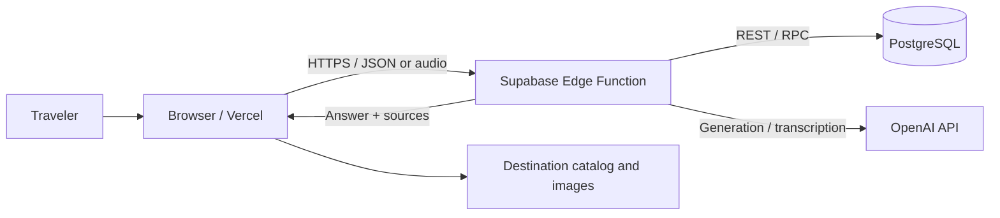

# Hallo Batam AI

**A bilingual, retrieval-grounded travel assistant for Batam, Indonesia.**

   

[Project website](https://batamtes.vercel.app/) · [Architecture](docs/ARCHITECTURE.md) · [Source code](supabase/functions/chat/index.ts) · [Verification workflow](https://github.com/fahmifaldi61-tech/wisatabatam/actions/workflows/verify.yml)

## Overview

Travel information is often fragmented across destination listings, operators and other sources. Hallo Batam AI combines a destination catalog with an Indonesian/English conversational interface, allowing users to explore places, ask questions and request travel itineraries through text and voice.

The frontend uses native HTML, CSS and JavaScript. The server-side implementation retrieves verified tourism documents through Supabase PostgreSQL REST/RPC, validates generated answers against source evidence and can fall back to checked data when an AI request fails.

> **Implementation verified on November 24, 2026:** the tracked TypeScript backend matches the active Supabase Edge Function `chat` v31 byte-for-byte. The Deno configuration matches semantically and the JWT setting matches. Database schema migrations are not yet included; the live database contents were not reverified on this date.

## Architecture



## Key features

- Indonesian and English travel chat, destination discovery and preferences.
- Verified-document retrieval, source-linked responses and itinerary constraints.
- Microphone capture, server-side audio transcription and browser speech synthesis.
- Opaque session tokens, rate limiting, request validation and conversation persistence.
- A curated catalog of 69 destinations, with 39 local and 30 remote photo references.
- Browser security headers, script integrity checks, Markdown sanitization and an explicit asset publication allowlist.

The retrieval code uses verified document queries and ranking. The historical database audit reported pgvector installed but no populated embeddings; active semantic vector search is not claimed.

## Engineering decisions

| Decision | Why it matters |
| --- | --- |
| Verified-document retrieval before generation | Limits unsupported travel claims and preserves source provenance. |
| Server-side AI and database access | Keeps provider credentials out of the browser. |
| Opaque session tokens and request budgets | Controls access and abuse without exposing database credentials. |
| Explicit asset manifest and CSP hashes | Keeps the published surface narrow and detects script/configuration drift. |
| Independent frontend and backend releases | Allows static website maintenance without redeploying the Edge Function. |

## Technology stack

| Layer | Technologies |
| --- | --- |
| Frontend | HTML, CSS, JavaScript, Marked.js, DOMPurify, Web Audio API |
| Backend | TypeScript, Deno, Supabase Edge Functions |
| Data | Supabase PostgreSQL, REST and RPC |
| AI | OpenAI API, text generation and audio transcription |
| Build & delivery | Node.js, Vercel, GitHub Actions |

## Repository layout

```text
.
├── .github/workflows/verify.yml
├── docs/
│   ├── ARCHITECTURE.md
│   ├── CODE_GUIDE.md
│   ├── DATABASE.md
│   ├── INTEGRATION_AUDIT.md
│   └── history/
├── supabase/
│   ├── config.toml
│   └── functions/chat/
│       ├── index.ts
│       └── deno.json
├── wisata_batam_project/
│   ├── assets/
│   │   ├── branding/
│   │   └── destinations/
│   ├── index.html
│   ├── build.cjs
│   ├── check-integrations.cjs
│   ├── vercel.json
│   └── *-photo-sources.json
├── .env.example
└── PORTFOLIO.md
```

## Getting started

Use Node.js 22, as configured in CI, and Git. No npm dependency installation is required for the checked-in build.

```bash
git clone https://github.com/fahmifaldi61-tech/wisatabatam.git
cd wisatabatam
node wisata_batam_project/check-integrations.cjs
node wisata_batam_project/build.cjs
```

Serve the generated frontend on port 8000. With Python 3 installed:

```bash
python -m http.server 8000 --directory wisata_batam_project/public
```

Open `http://localhost:8000`. The static server is for development; it does not reproduce Vercel's response headers. The browser's configured API targets a hosted service and requires service availability, allowed origins and valid sessions. Do not point tests at a production service without authorization.

### Backend configuration

See [environment template](.env.example) for names used in the Edge Function. Configure secrets only in an authorized server environment. The function expects existing PostgreSQL tables and RPCs described in [database notes](docs/DATABASE.md). A fresh end-to-end deployment cannot be reproduced from this repository alone until verified SQL migrations are supplied. Do not deploy this historical snapshot over a live function without comparing versions and testing in a separate environment.

### Verification

```bash
node wisata_batam_project/check-integrations.cjs
node wisata_batam_project/build.cjs
```

The checks validate repository contracts and the CSP/asset build, not live API availability, image licenses or end-to-end behavior.

### Deployment

Keep the Vercel root directory set to `wisata_batam_project`. The existing `vercel.json` runs `node build.cjs` and publishes `public/`. The build preserves existing public asset names. Supabase function deployment is separate; this repository cleanup does not deploy backend code or modify the database.

If inline JavaScript changes, review and update CSP with `node wisata_batam_project/build.cjs --update-csp` before running checks. Never weaken security headers merely to make a build pass.

## Product showcase

[Explore the project website](https://batamtes.vercel.app/) to see the interface and destination catalog. Hosted chat and voice features depend on service availability.

<!-- [INSERT SCREENSHOT / DEMO GIF HERE: homepage and destination catalog] -->
<!-- [INSERT SCREENSHOT / DEMO GIF HERE: bilingual chat response with linked sources and destination photos] -->
<!-- [INSERT SCREENSHOT / DEMO GIF HERE: voice transcription interface and itinerary response] -->

Screenshot capture and release verification instructions: [release checklist](docs/RELEASE_CHECKLIST.md) and [portfolio showcase guide](docs/PORTFOLIO_SHOWCASE.md).

## Documentation and credits

- [Architecture](docs/ARCHITECTURE.md) and [code guide](docs/CODE_GUIDE.md)
- [Database contract and limitations](docs/DATABASE.md)
- [Historical integration audit](docs/INTEGRATION_AUDIT.md) and [release checklist](docs/RELEASE_CHECKLIST.md)
- [Photo source references](wisata_batam_project/destination-photo-sources.json) and [remote photo references](wisata_batam_project/remote-destination-photo-sources.json)
- [Earlier Django/Chroma RAG prototype](https://github.com/fahmifaldi61-tech/wisatabatam-backend.) — not part of the current frontend request path.

Photo source attribution does not by itself establish redistribution rights; verify usage rights before republishing.
