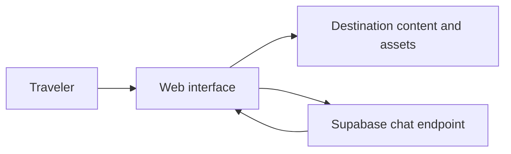

# Hallo Batam AI

**AI-assisted tourism discovery for Batam, Indonesia.**

   

## Overview

Hallo Batam AI brings destination discovery and a conversational travel assistant into a single web experience. The project explores how digital interfaces and AI can make tourism information more accessible.

## Highlights

- Destination discovery and detailed destination views.
- Conversational travel assistant connected to a Supabase Edge Function.
- Voice conversation interface, transcript and preference settings.
- Custom ocean-inspired visual design and curated destination photography.
- Vercel build with an explicit asset allowlist and Content Security Policy validation.

## Architecture



The [Django backend repository](https://github.com/fahmifaldi61-tech/wisatabatam-backend.) is a separate related implementation. The current frontend configuration points to Supabase, rather than directly to Django.

## Repository structure

| Path | Purpose |
| --- | --- |
| `wisata_batam_project/index.html` | Application interface and browser logic |
| `wisata_batam_project/DESIGN.md` | Design system |
| `wisata_batam_project/build.cjs` | Asset publishing and CSP checks |
| `wisata_batam_project/vercel.json` | Deployment configuration |
| `wisata_batam_project/*-photo-sources.json` | Destination image references |

## Run locally

Requires Node.js (a currently supported release).

```bash
git clone https://github.com/fahmifaldi61-tech/wisatabatam.git
cd wisatabatam/wisata_batam_project
node build.cjs
npx --yes serve public
```

Open the local URL shown by the server. The chat service depends on the configured remote endpoint and its availability. For deployment, use `wisata_batam_project` as the Vercel root directory; the checked-in configuration defines the build and output directory.

Do not put private API credentials into browser code. Review the CSP and deployment settings when changing scripts.

## More projects

[Developer portfolio — selected projects and live websites](PORTFOLIO.md)

[GitHub profile](https://github.com/fahmifaldi61-tech)
